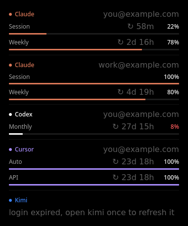

# Leftovers

A KDE Plasma 6 widget that shows how much of your AI coding plans you have left, with reset timers.



| Provider | Reads login from | Limits |
|---|---|---|
| Claude | `~/.claude/.credentials.json` | Session, Weekly, Weekly Opus/Sonnet |
| Codex | `~/.codex/auth.json` (falls back to session logs) | Session, Weekly / Monthly |
| Grok Build | `~/.grok/auth.json` | Weekly credits |

**Multiple accounts:** every config dir is an account. Anything matching `~/.claude*/`, `~/.codex*/` or `~/.kimi*/`
is picked up automatically, so `CLAUDE_CONFIG_DIR=~/.claude_work claude` or `CODEX_HOME=~/.codex-work codex`
show up as extra accounts: flip between them with the ‹ › arrows next to the provider name.

[T3 Code](https://github.com/pingdotgg/t3code) users get this for free: Claude and Codex instances from
**Settings → Providers** (including Codex shadow homes and ChatGPT accounts added there) are read from
`~/.t3/userdata/settings.json`, so the setups from its
[Claude](https://github.com/pingdotgg/t3code/blob/main/docs/user/providers-claude.md#separate-accounts-or-configurations) and
[Codex](https://github.com/pingdotgg/t3code/blob/main/docs/user/providers-codex.md#use-multiple-accounts) docs
show up without any extra config.

Account emails are blurred until you click one. On the desktop, push the card into a screen corner or
against an edge and it fills the gap and squares off those corners.

The panel shows the limit closest to running out. Logins are only read, never refreshed: if one expired,
open that CLI once and the widget catches up on its next poll (every 5 minutes).

## Install

```sh
git clone https://github.com/SusieeTheLinuxUser/leftovers
kpackagetool6 -t Plasma/Applet -i leftovers/package   # -u to upgrade
```

Then add **Leftovers** to a panel or the desktop. Needs `python3`, no other dependencies.

Debug the data side with `python3 package/contents/code/limits.py`.

## License

MIT
